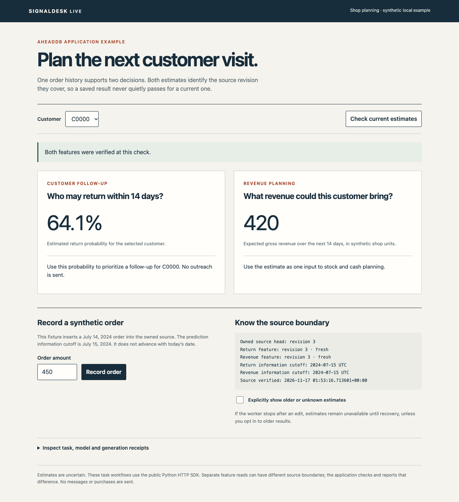

# AHEADDB Live

**Predictions that say which source they cover.**

A Python library and local PostgreSQL service for temporal predictions over
relational data. Source edits and refresh jobs commit together. Workers publish
complete, identified generations; current reads refuse uncovered, stale or unknown
results. The client can explicitly request an older result.

[Run the application](docs/live-quickstart.md) · [Python SDK](#use-the-library) ·
[HTTP contract](contracts/v1/openapi.json) · [Consistency](docs/live-design.md) ·
[Verification](docs/live-verification.md)



SignalDesk Live is the included shop-planning application. Choose a customer,
record a synthetic order, and check return probability and expected revenue.
If a worker stops, source entry stays available while uncovered estimates are
hidden. The app also hides old estimates during an unconfirmed edit. No outreach
or purchases occur. [Mobile capture](assets/live/current-mobile.png) ·
[Capture provenance](assets/live/current-capture.json).

## Run it locally

Python 3.12 or 3.13, uv and a dedicated PostgreSQL 15+ development source:

```sh
git clone https://github.com/nazeeh111/AHEADDB.git
cd AHEADDB
uv sync --frozen --extra live
# Set AHEAD_LIVE_DSN to your own dedicated development database.
uv run --no-sync ahead live demo
uv run --no-sync ahead live worker
```

In two more terminals, start the API and application. Only the API and worker
need the database setting:

```sh
uv run --no-sync ahead live serve
# Another terminal:
uv run --no-sync python examples/live_desk/app.py
```

Open **http://127.0.0.1:8791**. [Database setup and recovery walkthrough](docs/live-quickstart.md).
This is a synthetic, historical shop with a fixed July 15, 2024 information cutoff.
It needs no API key, model download, GPU or paid service.

## What is covered

| Surface | Contract |
|---|---|
| Source | Explicit entity/event keys, event and availability clocks; owned PostgreSQL edits with durable revision receipts |
| Tasks | Binary count/sum thresholds and numerical count/sum outcomes; mature labels and purged chronological evaluation |
| Models | Conventional CPU estimators, prior/historical comparisons and explicit model/preprocessing identities |
| Worker | Renewable leases, bounded compute lifetime, fencing, retry and atomic publication of complete generations |
| Reads | Task, model, information cutoff, source ID/revision, generation and freshness; explicit older-result opt-in |
| Recovery | Retention, source-bound purge ledger and portable data-only backups; fresh-namespace restore |
| Integration | Typed Python SDK, JSON CLI, v1 HTTP contract and an independent developer application example |

Separate latest-view reads are not mutually atomic. Compare source IDs and
revisions before combining them. A source check cannot detect an absent external
feed. This local implementation does not provide production authentication,
external CDC, automatic retraining, high availability or continuous WAL/PITR.
[Full boundaries](docs/live-design.md) · [Security](SECURITY.md).

## Development compiler and historical evidence

The current checkout is **0.3.1.dev0**. Its v4 compiler preserves large integer
sums and representable floating-point cancellation, rejects non-finite inputs
and true overflow, and distinguishes missing features from invalid labels.
Its preprocessing identity changed. **Old model recipes refuse reload** until
explicitly refitted; retain the previous source and backup for migration.
[Exact numerical semantics](docs/architecture.md).

Current root checks passed 130 core/adapter tests and 62 PostgreSQL Live integration cases,
plus Ruff and mypy. The shipped browser handler has a separate pending/unconfirmed
edit regression. These checks establish bounded software behavior, not forecast
quality. [Current verification and limits](docs/live-verification.md).

The v0.3.0 release, its recordings and 90-case workload study remain frozen.
The earlier public-data experiments include failures and mixed results. They
were **not rerun or resealed for the v4 compiler** and do not establish current
predictive quality or a general speed advantage.
[Historical overview](docs/historical-overview.md) · [Frozen Live workload](docs/live-results.md) ·
[Earlier temporal results](docs/v020-results.md) ·
[v0.3.0 release](https://github.com/nazeeh111/AHEADDB/releases/tag/v0.3.0).

## Use the library

```python
from aheaddb import Compiler, Snapshot
from aheaddb.demo import demo_schema, demo_tables, demo_tasks

snapshot = Snapshot(demo_tables(), demo_schema())
task = demo_tasks()[0]
print(Compiler(snapshot).plan(task, "2024-07-15"))
```

Declare your own `Schema`, `Event`, `Task` and `Outcome`; consume predictions
through `Engine` or the Live SDK. The [developer walkthrough](examples/live_developer.py)
declares an independent accounts/activity schema, evaluates temporal tasks,
publishes views and waits for its acknowledged edit revision. Its generated rows
are integration evidence. [SDK and temporal contracts](docs/architecture.md) ·
[Compatibility inspector](docs/quickstart.md) · [MCP integration](docs/agents.md).

## Verify a checkout

```sh
uv sync --frozen --extra dev --extra mcp --extra live
# AHEAD_TEST_POSTGRES must point only at a disposable test source.
uv run --no-sync pytest -q
node tests/live_desk.browser.mjs
uv run --no-sync ruff check src scripts tests examples/live_desk examples/live_developer.py
uv run --no-sync mypy src/aheaddb
uv build
```

Database tests skip without the explicit test connection. Optional FastDFS checks
need their separate extra. Public-data studies are separate, expensive experiments;
routine tests do not rerun them. Node is needed only for the small shipped-handler
regression, not for the application itself.

Apache 2.0 source. UCI-derived evaluation records retain CC BY 4.0 attribution.
[License](LICENSE) · [Data attribution](docs/data.md) ·
[Third-party research notices](docs/THIRD_PARTY_RESEARCH.md).
