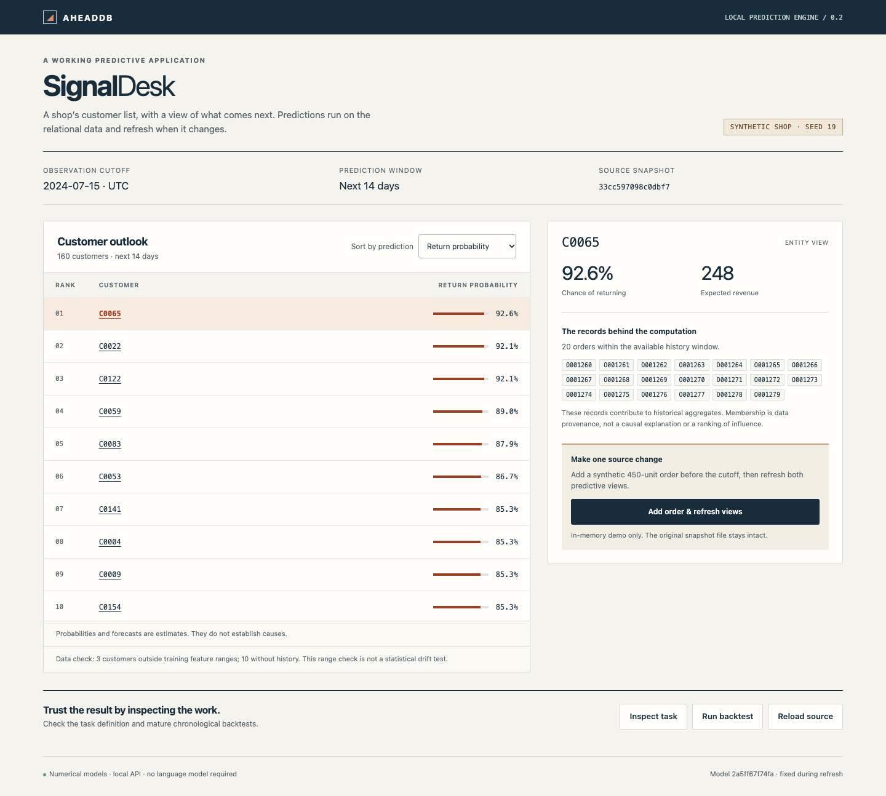
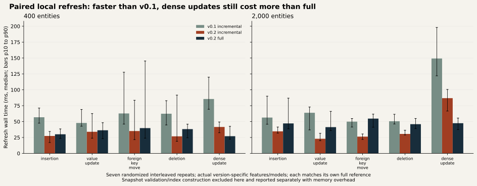
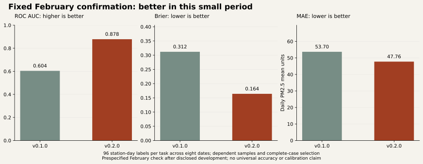
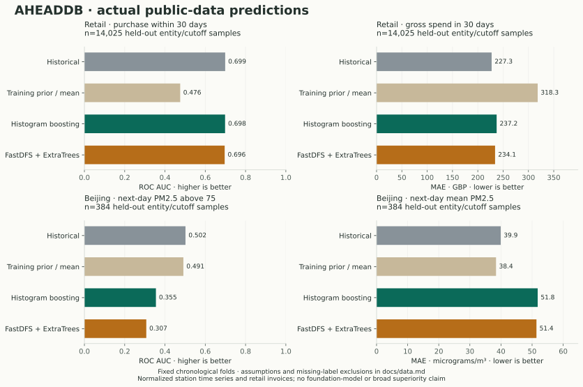

# AHEADDB

**Give your app a prediction engine, not another chatbot.**

[](https://github.com/nazeeh111/AHEADDB/actions/workflows/ci.yml)

[](assets/demo.mp4)

**SignalDesk is a working application, not a mock dashboard.** Its customer list consumes AHEADDB's local API for 14-day return probabilities and expected revenue. Select a customer to inspect source-record membership; add a synthetic order and watch the affected predictions refresh. The recorded update recomputed 2 predictions and reused 318. [15.1-second recorded playback](assets/demo.mp4) · [mobile view](assets/signaldesk-mobile.png). Demo data is explicitly synthetic; public-dataset evaluation is separate.

AHEADDB turns a declared relational snapshot into an inspectable temporal learning task, executes CPU statistical models, and maintains entity predictions as source data changes. Define the entity, outcome, cutoff, history window, horizon and metric. No LLM, API key, GPU or paid service is required for the numerical engine.

## Updated in 0.2.0

- Latest/trend/recent-window features and deployable persistence models, with selection on a purged training-only validation block.
- Mutation-safe model fingerprints with lower overhead, plus indexes for sparse entity context and source-owner lookup.
- Paired local benchmarks show 30.5–64.0% lower median wall time for common sparse changes at 2,000 entities versus v0.1. Dense updates still lose to full recomputation and indexes retain extra memory.
- Preserved negative first-stage results, a separately fixed February confirmation and current app recordings. [Results, limitations and migration](docs/v020-results.md).

## Run it locally

Python 3.12 and [uv](https://docs.astral.sh/uv/) are the tested route:

```sh
git clone https://github.com/nazeeh111/AHEADDB.git
cd AHEADDB
uv sync --frozen
uv run --no-sync ahead demo run/signaldesk
uv run --no-sync ahead serve
```

Open http://127.0.0.1:8787. Inspect a task, run its chronological backtest, select a customer, then add an order. Changes stay in the synthetic in-memory source; **Reload source** restores the original file. The server fits on startup and holds views in RAM. An existing demo directory is preserved; choose a fresh destination to generate another.

```sh
uv run --no-sync ahead plan
uv run --no-sync ahead backtest
uv run --no-sync ahead predict --csv run/predictions.csv
uv run --no-sync ahead inspect
```

[Full quickstart and task configuration](docs/quickstart.md) · [SignalDesk API example](examples/signaldesk/README.md) · [SDK example](examples/sdk.py) · [MCP and optional skill](docs/agents.md)

## Use the library

```python
from aheaddb import Compiler, Engine, Snapshot, fit
from aheaddb.demo import demo_schema, demo_tables, demo_tasks

snapshot = Snapshot(demo_tables(), demo_schema())
task = demo_tasks()[0]
print(Compiler(snapshot).plan(task, "2024-07-15"))
model = fit(snapshot, task, ["2024-03-01", "2024-04-01", "2024-05-01"], "2024-06-01")
engine = Engine(snapshot)
predictions = engine.materialize(task, model, "2024-07-15")
receipt = engine.refresh(snapshot)  # unchanged source: zero prediction work
```

Real projects declare `Schema`, `Event`, `Task` and `Outcome` explicitly. Read snapshots with `Snapshot.duckdb()`, `Snapshot.parquet()` or optional `Snapshot.postgres(caller_owned_connection, schema)`. PostgreSQL reads use a bounded repeatable-read, read-only transaction. Existing source schemas and credentials are not changed. [Exact temporal semantics and SDK contracts](docs/architecture.md).

## What 0.2 supports

| Capability | Supported contract |
|---|---|
| Schema | One entity table, multiple directly related event tables; explicit unique and foreign keys |
| Outcomes | Entity-level binary count/sum threshold; numerical future count/sum |
| Temporal validity | Event and availability clocks, left-open history, mature labels and purged chronological backtests |
| Models | Historical/prior comparisons, adaptive selection over conventional candidates using earlier purged validation; explicit histogram backend retained |
| Optional released pipeline | FastDFS 0.2.1 + ExtraTrees, evaluated separately; no foundation-model claim |
| Maintained serving | Core baseline/boosting models; shared task-independent contexts and selective invalidation |
| Sources | Read-only DuckDB/local Parquet; optional caller-connected PostgreSQL snapshot ingestion |
| Integration | Typed Python SDK, JSON CLI, local HTTP/OpenAPI, six stdio MCP tools and portable skill |
| Visibility | Source-record membership, versions, backtests, raw calibration, missing-history and range diagnostics |

Recommendations, arbitrary multihop joins, retrieval neighborhoods, automatic retraining/CDC, foundation-model serving, durable cross-process caches and production authentication are outside this release. FastDFS is a comparison adapter, not a maintained-view backend. Schema changes require retraining. The inspector is specific to SignalDesk; applications can use the SDK/API with their own vocabulary.

## Maintained predictive views

AHEADDB retains an immutable keyed row-fingerprint index. On changed data it finds insertions, updates and deletions, invalidates both old and new entity owners, refreshes each shared aggregate context once, then runs affected models independently. New records invalidate an owner even if they were absent from the previous history selection. Model/preprocessing changes and advancing cutoffs conservatively recompute predictions; unsupported schema changes fail explicitly. Views publish atomically only after successful computation.

A view key includes task, model, preprocessing, data version and cutoff. Reused results receive the new validated data version. Shared work is ordinary task-independent relational aggregation, never assumed sharing of task-conditioned model activations. [Algorithm, boundaries and data flow](docs/architecture.md).



The saved experiment compares full recomputation, whole-view caching and incremental refresh across insert/update/delete, foreign-key moves, late records, a high-degree owner, entity deletion, clock advancement and dense updates. Each version is checked against its own full feature/model recomputation; the new paired benchmark has 770 exact comparisons. **Reduced model work does not establish lower end-to-end cost**: fingerprint ingestion, retained-index storage and source scanning remain material. [Current measurements, memory, regressions and reproduction](docs/v020-results.md).

## Predictive quality, including failures

**New fixed February confirmation:** AUC improves **0.6039 → 0.8784**, Brier **0.3119 → 0.1641**, and regression MAE **53.70 → 47.76** (11.1% lower). This is only 96 station-day labels across eight dates, after disclosed development. Earlier regressions and historical-control tradeoffs remain visible. [Complete current evidence and migration](docs/v020-results.md).



The table below preserves the original **v0.1.0** results as historical evidence:

Actual held-out public-data results use the same chronological folds and labels across comparisons. Retail has 14,025 samples per task; Beijing has 384. These are small bounded experiments, not broad superiority evidence.

| Task / metric | Historical | Training prior/mean | Histogram boosting | FastDFS + ExtraTrees |
|---|---:|---:|---:|---:|
| Retail purchase 30d / ROC AUC ↑ |0.6989|0.4756|0.6983|0.6963|
| Retail gross spend 30d / MAE ↓ |227.32|318.31|237.23|234.13|
| Beijing next-day high PM2.5 / ROC AUC ↑ |0.5018|0.4913|0.3550|0.3072|
| Beijing next-day PM2.5 / MAE ↓ |39.92|38.41|51.81|51.41|



Neither learned pipeline wins consistently. Both fail badly on the Beijing classification experiment. The boosted retail model has 8 negative gross-spend estimates and large tail errors. Its retail Brier score improves over the historical probability estimate despite almost identical AUC. Raw probabilities are not guaranteed to be calibrated. [Reliability chart](assets/public-calibration.svg), [failure analysis and licenses](docs/data.md), and [complete JSON/CSV records](artifacts/results).

Both source datasets lack ingestion timestamps; availability clocks and source timezone are explicit experimental assumptions. Beijing uses complete next-day targets, creating selection bias. Entities recur across cutoffs. We do not claim zero-shot transfer, production accuracy or causal explanations from source membership. Choose models using validation and domain constraints; a more complex model is not automatically better.

## Research and comparison

Relational prediction, predictive SQL and incremental inference are established ideas. AHEADDB's contribution here is its implemented bounded execution method and reproducible measurements.

| System | Relevant capability | Relationship to AHEADDB 0.2 |
|---|---|---|
| [Kumo Engine](https://github.com/NVIDIA/kumo-engine) | Current local engine, predictive queries and relational model runtime | Local prediction alone is no distinction; AHEADDB focuses on inspectable CPU tasks and bounded maintained views |
| [RDBLearn](https://github.com/HKUSHXLab/rdblearn) / [FastDFS](https://github.com/HKUSHXLab/fastdfs) | Released relational feature pipeline plus estimators | Mature optional comparison, credited and actually executed |
| [RT-J](https://github.com/stanford-star/relational-transformer) | Released relational transformer/checkpoint workflow | GPU requirements exceed this Mac's route; not executed or advertised as supported |
| [RelBench](https://github.com/stanford-star/relbench) / [RelArena](https://github.com/PriorLabs/relarena) | Relational tasks, benchmarking and prediction interfaces | Important evaluation context; our two normalized datasets are smaller and less relationally demanding |
| [MindsDB](https://github.com/mindsdb/mindsdb) | Predictive SQL and AI/database integrations | Broader platform; this is a bounded local library with no agent framework |
| InkStream / RIPPLE++ | Incremental graph prediction prior art | Do not establish novelty or correctness for our different dependency contract |

[Source versions, current licenses, hardware and newer alternatives](docs/research.md) · [third-party research notices](docs/THIRD_PARTY_RESEARCH.md). The supplied arXiv 2601.12347 identifies RIPPLE++, not InkStream; both are credited separately.

## Reproduce and contribute

Use `scripts/evaluate_v020_confirmation.py`, `scripts/benchmark_v020.py` and `scripts/verify_v020.py` for the new paired results. The older evaluation commands below reproduce the original data-handling workflow but use the currently installed compiler; exact v0.1 results require that tag. First-stage v0.2 evidence requires commit `c2c392d`.

```sh
uv sync --frozen --extra dev --extra mcp
uv run --no-sync pytest -q
uv run --no-sync ruff check src scripts tests
uv run --no-sync mypy src/aheaddb
uv run --no-sync python scripts/benchmark_refresh.py
uv run --no-sync python scripts/fetch_public_data.py --dataset all
uv run --no-sync python scripts/evaluate_public.py --dataset all
```

Expensive public-data/FastDFS evaluations stay outside routine CI. CI separately exercises an actual disposable PostgreSQL 16 service. Optional dependency tests skip in the small core environment and are run explicitly for the release. See [current verification evidence](docs/v020-results.md), [optional backend environment](docs/research.md), [security scope](SECURITY.md) and [license attribution](docs/licenses.md).

Apache 2.0 source. UCI-derived evaluation records remain CC BY 4.0 with attribution. No upstream code/model weights are vendored. [LICENSE](LICENSE) · [NOTICE](NOTICE) · [data attribution](artifacts/results/NOTICE).
