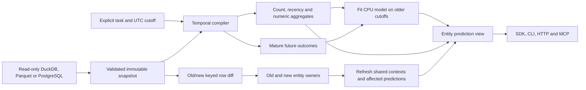

# Execution and correctness

AHEADDB 0.1 supports a declared star schema: one entity table and one or more event tables linked directly to entity keys. Each event has a unique stable key, occurrence time, availability time and optional numeric values. Arbitrary joins, recursive neighborhoods, recommendation tasks, production writes and automatic foundation-model selection are outside this version.

## Temporal definition

All naive timestamps explicitly mean UTC; aware timestamps convert to UTC. For cutoff `t`, history length `w`, horizon `h` and label delay `d`:

- Entity must be available at or before `t`.
- Feature events satisfy `t-w < occurred_at <= t` and `available_at <= t`.
- Labels aggregate `t < occurred_at <= t+h`, with information available at or before `t+h+d`.
- A label is mature only if `t+h+d <= as_of`.
- Each backtest fold trains only on earlier cutoffs whose labels are mature by the validation cutoff. Preprocessing and models fit inside that fold.

A binary outcome tests whether a declared count or numeric sum is **strictly greater** than its threshold. Regression predicts that count or sum. A sum of daily averages is a total of those averages, not a continuous physical integral. Missing numeric features have sum/mean zero plus an explicit missing count. Observed missing numeric **outcomes raise an error**. An absent event counts as zero only under the user's complete-event-log assumption. AHEADDB cannot infer whether a missing source row means no event or broken ingestion. Label delay represents reporting latency; records arriving after the fixed maturity deadline are excluded by definition.

The JSON task never contains executable Python or arbitrary SQL. `Compiler.plan()` shows temporal parameters, the count-query skeleton and the list of additional supported aggregates. The executed feature implementation is in `compiler.py`; the displayed query skeleton is not falsely presented as the complete numerical execution trace. Entity attributes are deliberately excluded because a present-day attribute is not necessarily historically available.

## Maintained predictive views

A context key contains schema, history window, exact cutoff and preprocessing version. Tasks with the same context may reuse **task-independent aggregates**. They never reuse task-conditioned neural activations. A prediction view is identified by task, model/preprocessing, data version and cutoff. Model identity includes fitted estimator state, training provenance, schema, ordered feature columns and sklearn version.

On refresh, AHEADDB hashes every declared source row by stable primary key using SHA256 and compares old and new snapshots. Any changed event invalidates both its old and new entity owners, including foreign-key moves and deletions. New rows invalidate owners even if the row was not previously selected. Added/deleted entities alter the view's population. Events outside the current window still conservatively invalidate their owners. This trades some avoidable work for simple, auditable correctness.

Each shared context is updated once, then each affected model runs independently. Proven unchanged results are carried into the **new data-version view**, with a newly derived cache key. A data-version change never authorizes blind cache reuse. Ordinary caching in the benchmark invalidates the whole view on source-version changes. Clock advancement, preprocessing changes and model changes trigger full prediction recomputation. Clock/preprocessing changes rebuild contexts. A schema change is rejected and requires a new engine plus retraining. Refresh commits views only after every computation succeeds. Unreachable old-window contexts are dropped.

This method does not avoid scanning source data: diff discovery is O(source rows), holds old/new snapshots in RAM and may dominate small-model inference. Dense updates, high-degree owners and clock advancement can remove its advantage. It is not a database change-data-capture system. Safe multihop invalidation, ANN retrieval neighborhoods, automatic retraining, online calibration, durable view recovery and cross-process coordination are future work. The optional FastDFS comparator runs its own time-guarded feature pipeline and is not eligible for this engine's incremental cache.

## Operational scope

The SDK runs in one process. `Project` serializes HTTP/MCP accesses with a lock. DuckDB/Parquet and optional caller-connected PostgreSQL sources are read-only; the example mutation replaces only a synthetic in-memory snapshot. Restarting the server refits the fixed training specification and reloads the original database. There is no unsafe pickle loading or model artifact execution. Snapshot methods accept at most two million rows by default; DuckDB reads have a 512MB memory limit and two threads. HTTP binds only to loopback through the CLI, rejects foreign origins/hosts and exposes no arbitrary file path/query tool. Do not expose this unauthenticated development inspector to a network.

Row fingerprints are computed once during immutable snapshot ingestion and retained as a keyed SHA256 index. Refresh compares that index rather than hashing unchanged source bytes again. Identical validated data versions skip diff discovery. Snapshot construction and retained-index memory remain real costs; the benchmark reports them separately from refresh latency. Ordinary cache no-ops reuse contexts directly without filtering source events.
