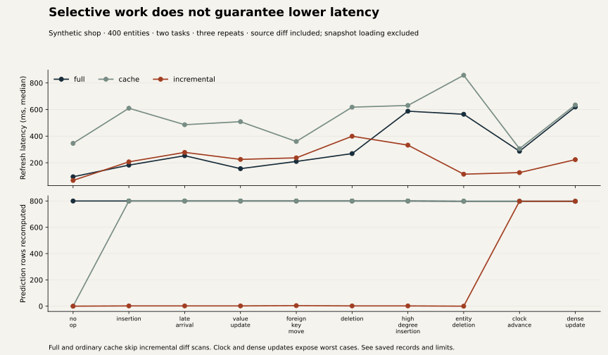

# Maintained-view refresh measurements

These are synthetic update stress tests, separate from the UCI prediction-quality experiments. The saved seed 19 stream has400entities, two fitted tasks and 10 scenarios. Each mode runs the same sequential immutable snapshots three times in a seeded shuffled mode order. Every output is compared against independent full feature construction plus model prediction. All 90mode/scenario/repeat comparisons agree exactly: maximum absolute prediction difference 0.

## Results

Times below are observed median wall-clock milliseconds, not controlled throughput estimates. The local host was doing other work; three repeats cannot separate every scheduling effect from engine work. Source snapshot construction is excluded from refresh timing and reported separately. Full/cache do not run incremental dependency discovery. Same-version snapshots skip diff discovery, and cache no-ops do not filter events.

| Update | Full ms | Ordinary cache ms | Incremental ms | Full prediction rows | Incremental prediction rows |
|---|---:|---:|---:|---:|---:|
| No change |94.67|345.80|67.30|800|0|
| Insertion |182.18|609.86|206.81|800|2|
| Late arrival |252.97|485.98|277.96|800|2|
| Value update |155.69|508.77|225.24|800|2|
| Foreign-key move |209.83|359.80|236.90|800|4|
| Deletion |268.86|617.80|399.33|800|2|
| High-degree insertion |587.51|630.54|332.46|800|2|
| Entity deletion |564.53|857.72|114.18|798|0|
| Clock advancement |286.77|305.74|126.00|798|798|
| Dense update |619.20|634.42|223.41|798|798|



Selective invalidation reduces prediction work sharply for sparse changes. **It is slower than full recomputation in five sparse-change cases in this run.** The models and aggregates are small enough that owner-diff and bookkeeping costs can outweigh saved inference. The ordinary cache's surprisingly slow no-op and large mode variability show why these wall times must not be read as a clean microarchitectural ranking. No universal latency or cost reduction is claimed.

Clock advancement and dense updates recompute every prediction. Their lower recorded incremental wall times cannot be attributed to selective model work, since that work is identical. High-degree insertion here means120newrecords for one owner, not a general graph hub influencing arbitrary neighbors. A broad graph/query workload is outside this engine's supported contract.

## Sharing and memory

The two tasks have the same history/schema/cutoff, so they share task-independent aggregate context. The separate-engine comparison constructs 800 feature rows and retains 75,200 bytes of pandas context storage; shared construction uses 400 rows and 37,600 bytes. Across three runs, observed median materialization time was 572.15 ms shared versus 1,281.52 ms separate. This measures feature construction plus prediction using already fitted models; it does not establish broader throughput or statistical significance. Model activations are never shared.

The retained per-row SHA256 index uses approximately 1.35–1.37MB while the source pandas tables use1.04–1.12MB. Index overhead is substantial and is the price of comparing source fingerprints without repeatedly rehashing unchanged bytes. Snapshot ingestion/validation/index construction costs 239–540ms per saved snapshot in this run, before refresh. None of those costs disappear when prediction rows are reused. A whole-view cache needs only a source version, so it could omit the per-row index in a specialized ingestion path; this implementation uses the same validated `Snapshot` for every comparison.

Cumulative process peak RSS was 202,555,392 bytes, including imports, models and all prebuilt snapshots. It is not per-mode incremental allocation. Context-byte counts measure pandas storage, not every Python allocator or model object. Old/new snapshots coexist during a refresh. Scaling this in-memory method to millions of records needs a different source-diff/index storage strategy.

## Reproduce and inspect

```sh
uv sync --frozen --extra dev
OMP_NUM_THREADS=1 OPENBLAS_NUM_THREADS=1 VECLIB_MAXIMUM_THREADS=1 LOKY_MAX_CPU_COUNT=1 \
  uv run --no-sync python scripts/benchmark_refresh.py --entities 400 --repeats 3
uv run --no-sync python scripts/verify_artifacts.py
```

The source stream, exact task definitions, per-repeat timings, recomputed feature/prediction rows, sharing records, ingestion measurements and platform are saved in [`refresh.json`](../artifacts/results/refresh.json). Refresh runs one numerical thread on macOS 26.6.2 arm64/Python 3.12.13; no GPU, API or model pretraining is used. Data generation, fitting and independent reference validation are outside timed refresh. Source fingerprints/row-index creation are outside timed refresh but measured separately. Dependency comparison and view/model identity checks are inside it.

To regenerate charts install Matplotlib 3.10.7 in a separate plotting environment and run `scripts/plot_refresh.py` and `scripts/plot_public.py`. They read saved records only. Set `MPLCONFIGDIR` to a writable task-local or temporary cache. Numerical charts are standard Matplotlib SVG/PNG outputs, not generated illustrations.
